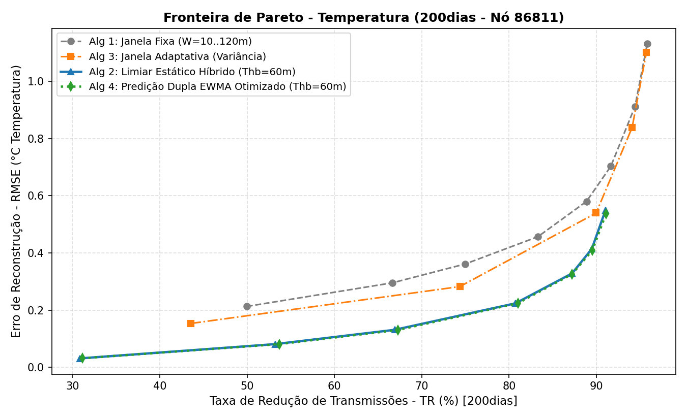
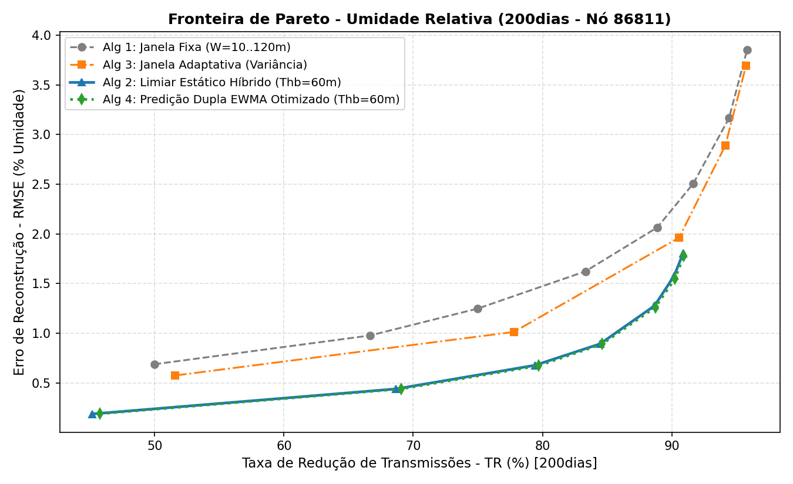
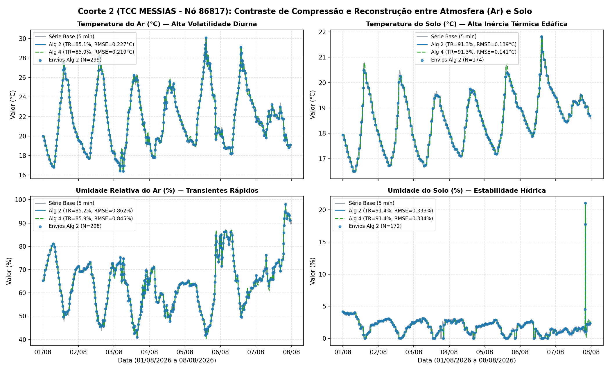

# Rede de Sensores Sem Fio na Agricultura de Precisão: Desenvolvimento de Dispositivos IoT para Coleta de Dados em Lavouras Cafeeiras do Brasil

[](https://fapesp.br/)
[](https://www.icmc.usp.br/)
[](https://www.python.org/)

Repositório oficial dos códigos-fonte, conjuntos de dados padronizados, simulações orientadas a rastro (*Trace-Driven Simulation*), figuras e relatórios técnicos do projeto de Iniciação Científica (FAPESP) desenvolvido no **Laboratório de Sistemas Distribuídos e Programação Concorrente (LaSDPC — ICMC/USP São Carlos)**.

- **Pesquisador:** Pedro Dorigatti Aureo Ferreira (Engenharia de Computação — ICMC/USP)
- **Orientador:** Prof. Dr. Julio Cezar Estrella (LaSDPC — ICMC/USP)

---

## 1. Visão Geral e Metodologia Experimental

Na primeira fase desta pesquisa (publicada no **34º SIICUSP** sob o título *"Analysis and Selection of Communication Technologies for Sensor Networks in Precision Agriculture"*), identificou-se que a tecnologia **LoRa / LoRaWAN** é a mais adequada para cobrir extensões rurais com topografia acidentada e folhagem densa típicas da cafeicultura brasileira. Contudo, o elevado *Time-on-Air* ($\text{ToA}$) da modulação CSS impõe dois gargalos críticos quando centenas de nós transmitem periodicamente em alta frequência:
1. **Drenagem acelerada da bateria** dos nós sensores em campo;
2. **Degradação da taxa de entrega de pacotes ($\text{PDR}_{\text{MAC}}$)** devido a colisões no canal ALOHA puro utilizado pelo LoRaWAN Classe A.

Para validar algoritmos de **agregação e supressão temporal (*in-network processing*)** e **agregação espacial (*Cluster Head*)** com reprodutibilidade científica e sujeitos a imperfeições reais de hardware e rede (ruído de transdução, *jitter*, *outliers* e quedas de conectividade), adotou-se a metodologia de **Simulação Orientada a Rastro (*Trace-Driven Simulation*)** sobre **200 dias contínuos** (`01/03/2026` a `16/09/2026`, resolução de `5 minutos`, `1.534.142` observações válidas) coletados no **Testbed Experimental Controlado Koala** (LaSDPC/ICMC-USP).

---

## 2. Organização do Repositório e Entregáveis

```text
IC/
├── E2/                                   # Entregáveis E1 e E2: Sondagem e Extração via API REST
│   ├── sondagem.py                       # Varredura exploratória de ambientes e dispositivos na API
│   ├── sondagem_complementar.py          # Mapeamento fino de sensores ativos em 2026
│   └── extracao.py                       # Pipeline de extração paginada (overlap 12h), limpeza e QoS bruto
│
├── dataset_koala_e2/                     # Entregáveis E2 e E5 (Bloco A): Datasets Padronizados
│   ├── README.md                         # Documentação detalhada e dicionário de dados
│   ├── koala_dataset_mestre_5min.csv     # Série temporal mestre (1.534.142 linhas, formato longo) [Git LFS]
│   ├── koala_cluster_externo_wide_5min.csv # Matriz alinhada dos 9 nós externos (107.363 linhas, formato wide)
│   ├── koala_auditoria_qos_bruto.csv     # Métricas empíricas de rede (PDR, Jitter, MTTR, Lacunas)
│   └── koala_dicionario_dispositivos.csv # Catálogo dos 14 nós sensores divididos em 4 coortes
│
├── E3/                                   # Entregável E3: Análise Exploratória de Séries Temporais
│   └── gerar_series.py                   # Geração de gráficos de 200 dias, médias móveis, lacunas e solo vs. ar
├── figuras_e3/                           # Gráficos exploratórios em alta resolução (300 DPI)
│
├── E4/                                   # Entregável E4: Algoritmos de Agregação Temporal e Espacial
│   ├── 200_dias_temp.py                  # Fase 1: Grid Search 4D (15d), Fronteira de Pareto e validação 200d (Temp)
│   ├── 200_dias_um.py                    # Fase 1: Grid Search 4D (15d), Fronteira de Pareto e validação 200d (Umid)
│   ├── reconstrucao_validacao.py         # Validação de reconstrução no servidor (72h) e erro instantâneo
│   ├── coortes_ar_solo_indoor.py         # Fase 2: Avaliação multi-coorte (Ar vs. Solo agrícola e regime Indoor)
│   ├── anomalias_alertas.py              # Fase 2/3: Latência de Alerta (Δt_alerta) em anomalias reais e sintéticas
│   └── cluster_head_espacial.py          # Fase 3: Simulação de Cluster Head espacial e tolerância a Node Death
│
├── resultados_e4_fase1_temperatura/      # Curvas de Pareto e tabela de benchmark global (Temperatura)
├── resultados_e4_fase1_umidade/          # Curvas de Pareto e tabela de benchmark global (Umidade Relativa)
├── resultados_e4_reconstrucao/           # Painéis de reconstrução (72h) e controle determinístico de erro
├── resultados_e4_coortes/                # Comparativos Ar vs. Solo (TCC Messias) e síntese dos 4 coortes
├── resultados_e4_anomalias/              # Avaliação de surtos térmicos reais e injeção de geada/chuva sintética
├── resultados_e4_cluster_head/           # Calibração de τ_espacial, economia em cascata e falha do nó 86812
│
├── docs/                                 # Documentação Técnica, Planilha PRISMA e Relatórios Parciais
│   ├── contexto_mestre_ic_fapesp_koal_rssf.md # Documento de arquitetura experimental e diretrizes do projeto
│   ├── dados_extraidos.md                # Relatório técnico dos Entregáveis E1, E2 e E5-Bloco A
│   ├── planilha_prisma_pedro.xlsx        # Planilha do levantamento bibliográfico PRISMA (275 registros)
│   ├── relatorio_e4_agregacao_temporal.md # Relatório técnico-científico completo do Entregável E4
│   └── Próximas etapas.md                # Planejamento do funil experimental em 3 fases
│
├── .env.example                          # Modelo de variáveis de ambiente para acesso à API do Koala
└── requirements.txt                      # Dependências Python do projeto
```

---

## 3. Coortes Experimentais (14 Dispositivos)

| Coorte | Ambiente | Dispositivos (IDs) | Grandezas Medidas | Papel Científico na Simulação |
| :--- | :--- | :--- | :--- | :--- |
| **1. `Externo_Cluster`** | `Externo` (Amb. 4) | 9 nós (`86809`, `86811`, `86812`*, `86813`, `86814`, `86784`, `86785`, `86783`, `46`) | Temperatura (`°C`), Umidade (`%`) | Transecto externo ("talhão virtual") sujeito ao ciclo solar diurno e microclimas locais; validação de agregação temporal, espacial (*Cluster Head*) e *Node Death* (`86812`). |
| **2. `Agricola_Solo`** | `Externo` (Amb. 4) | 1 estação multi-sensor (`86817` — `TCC MESSIAS`) | Temp. Ar, Umid. Ar, **Temp. Solo**, **Umid. Solo**, Fluxo | Contraste direto entre a volatilidade atmosférica (ar) e a alta inércia térmica/hídrica edáfica (solo). |
| **3. `Indoor_Baseline`** | `Lab 1006` (Amb. 1) | 2 nós (`1` — `TEMP2`, `86782` — `TEMP4`) | Temperatura (`°C`), Umidade (`%`), Luminosidade | Regime climatizado estável para demonstrar o limite assintótico superior de compressão ($TR\% \to 90\%+$). |
| **4. `Cluster_Server`** | `Cluster 1006` (Amb. 3) | 2 nós (`86794`, `86795`) | Temperatura (`°C`), Umidade (`%`) | Sala de servidores com eventos reais de falha de refrigeração e surto térmico ($51,2^\circ\text{C}$) para análise de **Latência de Alerta ($\Delta t_{\text{alerta}}$)**. |

---

## 4. Algoritmos Avaliados

### 4.1. Supressão Temporal no Nó Sensor (Nível Folha)
1. **Algoritmo 1 — Agregação por Janela Temporal Fixa (*Baseline Time-Driven*):** Envia 1 pacote a cada janela fixa $W \in \{15, 30, 60\}\text{ min}$, mantendo retenção de ordem zero (*Zero-Order Hold* — ZOH) no servidor.
2. **Algoritmo 2 — *Duty-Cycle* Híbrido por Limiar Estático (Proposta SIICUSP):** Transmite se e somente se $|y_t - y_{\text{last}}| \ge \delta$ (gatilho de evento) ou $(t - t_{\text{last}}) \ge T_{\text{hb}}$ (gatilho de *heartbeat*). Garante erro instantâneo estritamente limitado ($|y_t - \hat{y}_t| < \delta$) com complexidade $\mathcal{O}(1)$.
3. **Algoritmo 3 — Janela Adaptativa Baseada em Variância (*Adaptive Windowing*):** Modula dinamicamente a janela $W_{\text{atual}} \in [W_{\min}, W_{\max}]$ de forma inversamente proporcional ao desvio padrão móvel $\sigma_k$ das últimas $k=6$ leituras.
4. **Algoritmo 4 — Predição Dupla Linear Amortecida via EWMA (*Dual Prediction Scheme / Holt Damped*):** Nó e servidor executam um preditor linear com tendência amortecida ($\alpha, \beta, \phi$) e banda morta (*deadband*), suprimindo transmissões durante rampas térmicas/hídricas previsíveis enquanto $|y_t - \hat{y}_t^{\text{serv}}| < \epsilon$.

### 4.2. Agregação Espacial Multi-Sensor (*Cluster Head*)
- Os nós-folha reportam suas leituras filtradas para o *Cluster Head* local, que computa a mediana espacial do talhão $M_t$ e o desvio máximo $\Delta_{\max} = \max_i |v_i - M_t|$.
- Se $\Delta_{\max} \le \tau_{\text{espacial}}$, o *Cluster Head* envia apenas **1 pacote LoRaWAN** com a mediana $M_t$; se $\Delta_{\max} > \tau_{\text{espacial}}$, reporta a mediana acompanhada da identificação e leitura dos nós discrepantes.

---

## 5. Principais Resultados Experimentais

### 5.1. Benchmark Global nos 200 Dias Completos (Nó `86811` — Coorte 1)

| Grandeza | Algoritmo | Pacotes Transmitidos | Taxa de Redução ($TR\%$) | $\text{MAE}$ | $\text{RMSE}$ | $\text{ErroMáx}$ |
| :--- | :--- | :---: | :---: | :---: | :---: | :---: |
| **Temperatura** ($53.659$ amostras) | Alg 1 ($W=30\text{m}$) | 8.954 | 83,31% | 0,3072 °C | 0,4570 °C | 4,844 °C |
| **Temperatura** ($53.659$ amostras) | **Alg 2 ($\delta=0,5^\circ\text{C}, T_{\text{hb}}=60\text{m}$)** | **10.335** | **80,74%** | **0,1687 °C** | **0,2239 °C** | **0,499 °C** |
| **Temperatura** ($53.659$ amostras) | Alg 3 ($\sigma=[0,15; 0,85], W=[5, 60]\text{m}$) | 5.384 | 89,97% | 0,3948 °C | 0,5395 °C | 2,479 °C |
| **Temperatura** ($53.659$ amostras) | **Alg 4 ($\epsilon=0,5^\circ\text{C}, T_{\text{hb}}=60\text{m}, \phi=0,75$)** | **10.191** | **81,01%** | **0,1687 °C** | **0,2241 °C** | **0,500 °C** |
| **Umidade Relativa** ($53.644$ amostras) | Alg 1 ($W=30\text{m}$) | 8.953 | 83,31% | 1,0311 % | 1,6221 % | 44,645 % |
| **Umidade Relativa** ($53.644$ amostras) | **Alg 2 ($\delta=2,0\%, T_{\text{hb}}=60\text{m}$)** | **8.341** | **84,45%** | **0,6827 %** | **0,8923 %** | **2,000 %** |
| **Umidade Relativa** ($53.644$ amostras) | **Alg 4 ($\epsilon=2,0\%, T_{\text{hb}}=60\text{m}, \phi=0,82$)** | **8.264** | **84,59%** | **0,6805 %** | **0,8901 %** | **2,000 %** |

<p align="center">
  
  
</p>

### 5.2. Contraste Atmosfera (Ar) vs. Solo Agrícola (Estação `TCC MESSIAS` — Nó `86817`)
- Devido à alta inércia térmica e hídrica edáfica, os algoritmos orientados a eventos atingem **$TR = 91,00\%$ na temperatura do solo** e **$TR = 91,23\%$ na umidade do solo** (próximo ao limite teórico de $91,67\%$ imposto pelo *heartbeat* de $60\text{ min}$), mantendo erro máximo estrito de $0,5^\circ\text{C}$ e $2,0\%$.
- Nas rampas solares suaves da estação agrometeorológica, o **Algoritmo 4 (Predição Dupla EWMA)** supera o Algoritmo 2 na temperatura do ar ($TR = 86,01\%$ vs. $84,92\%$) e na umidade do ar ($TR = 86,30\%$ vs. $85,53\%$).

<p align="center">
  
</p>

---

## 6. Como Reproduzir os Experimentos

### 6.1. Instalação das Dependências
```bash
pip install -r requirements.txt
```

> **Nota sobre o Dataset Mestre:** O arquivo `dataset_koala_e2/koala_dataset_mestre_5min.csv` (~144 MB) é versionado via **Git LFS**. Ao clonar o repositório, certifique-se de ter o [Git LFS](https://git-lfs.com/) instalado (`git lfs install && git lfs pull`).

### 6.2. Execução dos Scripts (E3 e E4)
Todos os scripts de análise e simulação leem diretamente os dados consolidados em `dataset_koala_e2/` e podem ser executados a partir da raiz do projeto:

```bash
# Entregável E3: Gráficos exploratórios, médias móveis e identificação de lacunas
python E3/gerar_series.py

# Entregável E4 (Fase 1): Calibração via Grid Search, Fronteira de Pareto e validação de 200 dias
python E4/200_dias_temp.py
python E4/200_dias_um.py

# Entregável E4 (Reconstrução): Inspeção de 72h e validação do limite determinístico de erro
python E4/reconstrucao_validacao.py

# Entregável E4 (Fase 2): Comparativo Ar vs. Solo (TCC Messias) e síntese dos 4 coortes
python E4/coortes_ar_solo_indoor.py

# Entregável E4 (Fase 2/3): Latência de alerta em anomalias reais e eventos climáticos sintéticos
python E4/anomalias_alertas.py

# Entregável E4 (Fase 3): Simulação conjunta Nó-Folha + Cluster Head espacial
python E4/cluster_head_espacial.py
```

### 6.3. Extração a partir da API do Koala (Entregáveis E1/E2 — Opcional)
Caso deseje executar novamente a coleta diretamente da API interna do laboratório (requer acesso à rede do LaSDPC/ICMC-USP):
1. Copie o arquivo `.env.example` para `.env` e preencha suas credenciais (`KOALA_USERNAME` e `KOALA_PASSWORD`);
2. Execute `python E2/extracao.py`.
